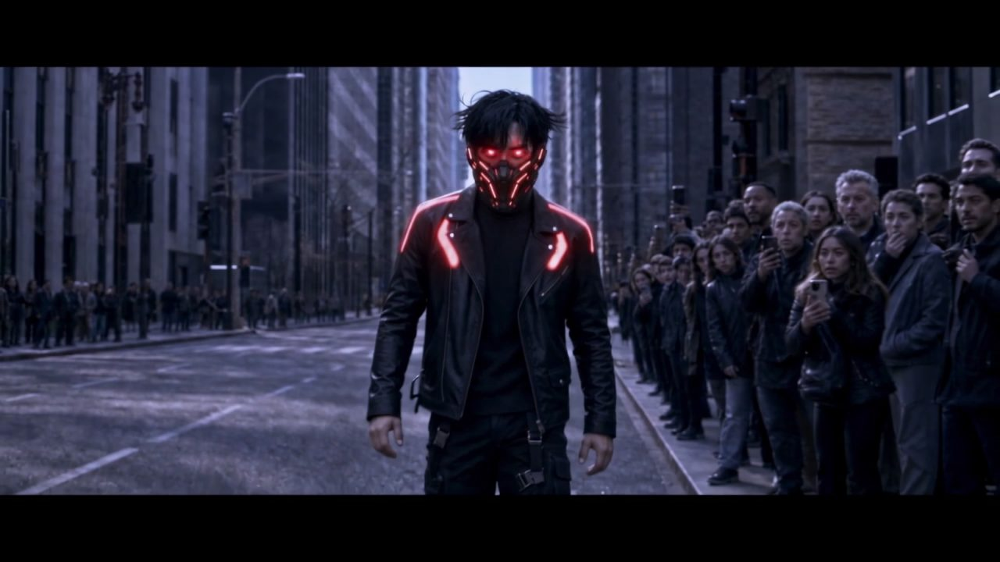
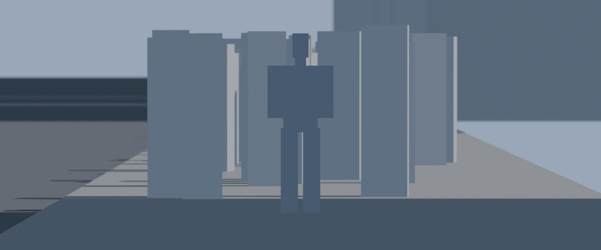
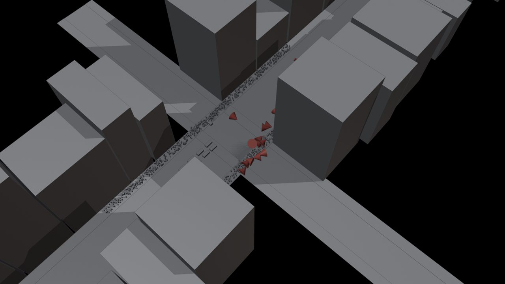

# AI Filmmaking Pipeline — KIMKATCHER

**An agentic production pipeline for AI-generated short films, built and documented by Jérémie Borrotzu (Lyon, France).**

KIMKATCHER is a micro action series made entirely with generative AI: no camera, no actors, no real set.
Episode 1 is 1 min 50, produced in 4 days for less than €150 of generation.
The film itself is a proof of concept. **The real subject is the method**: how to turn generative models,
which drift, hallucinate and ignore instructions, into a predictable and reproducible production.

**Second project, in development: [IF](if/README.md)**, a stylized 3D cartoon built from my own drawings
(sketch, style bible, turnaround, rigged 3D model, Blender layout, AI repaint).

> **Why this repository is public.** I build learning and production systems with AI, and I believe a method is
> only worth something if others can reuse it. This repo shows how I work: I build the pipeline myself, I turn every
> failure into a documented rule, I track costs from day one, and I write it up so a team can learn it.
> It is the same approach I applied at scale to content production and AI adoption in my professional work.



---

## The core idea

Most AI videos cannot be edited together: characters drift from shot to shot, directions flip, the camera does
whatever it wants. This pipeline treats the film as a **production**, not a sequence of prompts:
every decision the model would otherwise guess (references, camera, continuity) is made **before** generating,
and an agent enforces those decisions.

| Blender blocking (control image) | Final shot |
|---|---|
|  |  |
|  |  |

## The pipeline in 7 steps

| # | Step | Tools (episode 1) | Who |
|---|---|---|---|
| 1 | Shot breakdown: shot size, focal length, duration | [`episode-01/SEQUENCE.md`](episode-01/SEQUENCE.md) | director |
| 2 | Locked visual bible: one reference per character state, sets, lighting | GPT Image 2, Grok Imagine | director |
| 3 | 3D blocking: set, real cameras, timing | Blender, driven through MCP | agent |
| 4 | Prompt generated **from the 3D scene** (camera, focal, framing, continuity, exclusions) | [`scripts/prompt_depuis_scene.py`](scripts/prompt_depuis_scene.py) | agent |
| 5 | Keyframes: first and last image when a shot changes state | GPT Image 2 | director |
| 6 | Video: the model interpolates between validated images, it no longer invents | Seedance 2.5 on Runway | agent or director |
| 7 | Post-production: music, sound, voice, upscale, edit | Suno, MMAudio, ElevenLabs, Topaz, Final Cut Pro | director |

**Orchestration:** Claude Code drives Blender and Runway through the Model Context Protocol (MCP), checks
continuity (180° rule, movement continuity, scale progression) and logs every decision and every credit spent.



## Rules that work

1. **Bible first.** Consistency comes from reusing references, not from generating more.
2. **The camera is decided in 3D.** A prompt cannot hold a focal length; a Blender camera can. The grey render is the control image.
3. **Pilot shot.** Run one shot end to end before anything else, to calibrate the pipeline.
4. **Keyframes.** The video model interpolates, it doesn't invent. Generate the last frame from the references, never by editing the first one.
5. **Continuity.** 180° rule, movement continuity, eyelines led by motion, cut on action, scale progression.
6. **Faces.** Attach the face reference whenever a face can appear.
7. **Costs.** One generation at a time, explicit approval, balance logged before and after ([`episode-01/COSTS_FR.md`](episode-01/COSTS_FR.md)).
8. **Log everything.** A journal plus Git turn a pile of prompts into a reproducible production.

## Lessons from directing the models

- **The model doesn't know its right from its left.** Name hands A and B and anchor them to the set ("the hand on the lamppost side").
- **One camera between two keyframes.** Two different focal lengths and the model invents a crane move that warps the set.
- **"Power" is not special effects.** Ask for power and you get explosions; power comes from speed, gesture and sound.
- **The agent must keep the director's words.** An agent that "improves" a prompt with an unrequested glance costs credits. It translates, proposes, and asks before changing intent.

## Repository map

```
method/        Method, setup (Blender MCP, Runway MCP), approach (French originals)
bible/         Locked visual bible: characters, continuity, references, flow
episode-01/    Shot breakdown, sound design notes, cost log, example shots
  shots/       Real prompts and step-by-step instructions for 4 shots
scripts/       Reusable Blender and pipeline scripts (prompt from scene, renders, ProRes conversion)
images/        Making-of stills
```

Media files (videos, audio, Blender scenes, Final Cut libraries) are not versioned. Paths in scripts are
relative to the project root and must be adapted to your machine.

## How I would teach this pipeline

This repository is also a teaching artifact. If I had to onboard a team of creatives or engineers on it:

1. **Start with one shot, end to end** (the pilot shot): bible, blocking, prompt from scene, keyframes, video, edit. People learn the pipeline by shipping one real result, not by reading about it.
2. **Make every failure a rule.** Each lesson above came from a failed generation. The method grows from documented mistakes, shared in the journal.
3. **Separate what the human decides from what the agent executes.** Creative intent, references and validation stay human; repetitive, measurable work goes to the agent.
4. **Measure costs from day one.** Credits per shot, retries, refunds. Cost awareness is part of craft, not an afterthought.

## About me

25 years of art direction, illustration and digital learning production; 4 years building agentic AI production
pipelines (n8n, Python, Claude and OpenAI APIs, MCP) and leading AI adoption with non-technical teams.

- Episode 1 and making-of: see my LinkedIn posts
- LinkedIn: [linkedin.com/in/jborrotzu](https://www.linkedin.com/in/jborrotzu)
