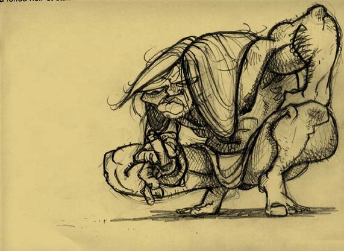
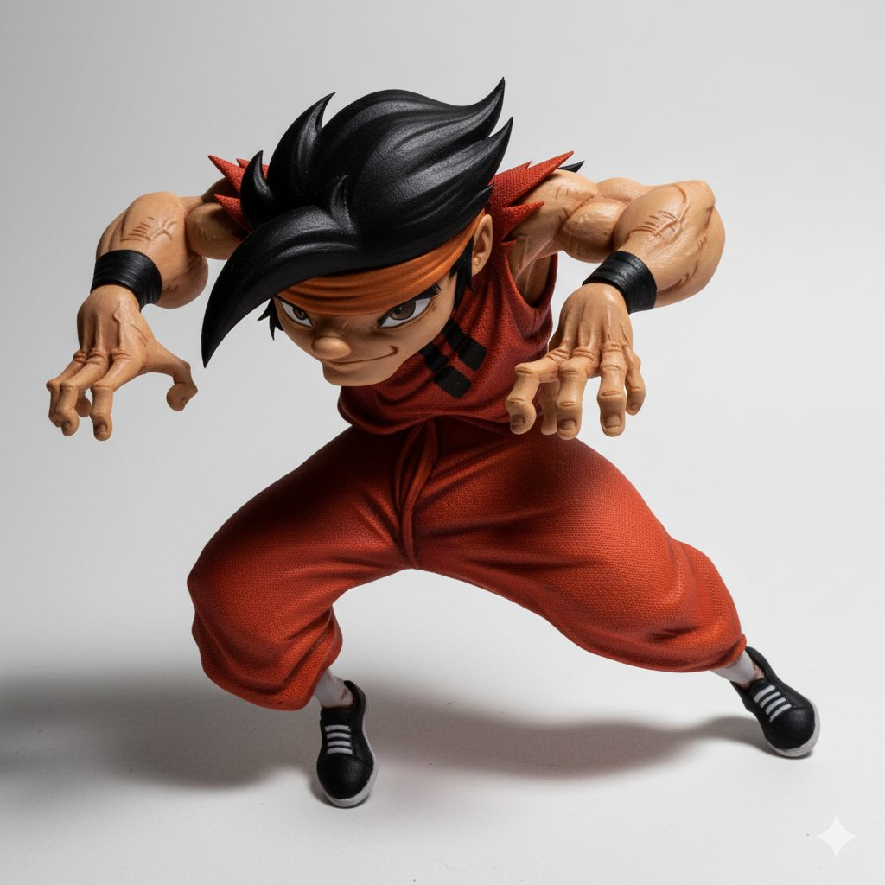
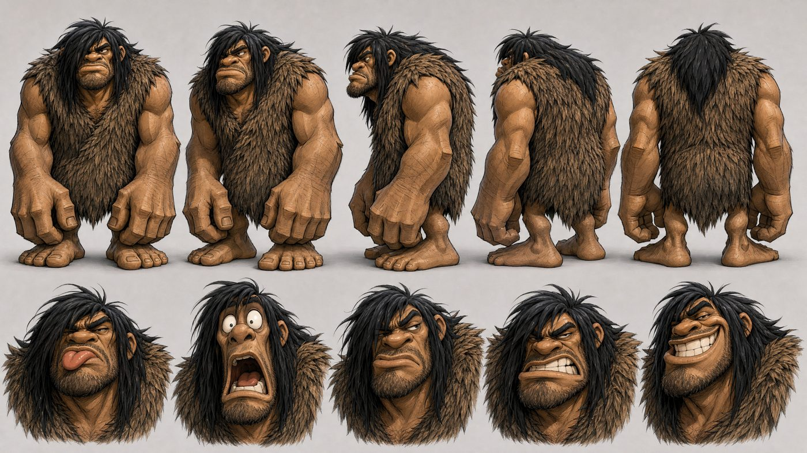
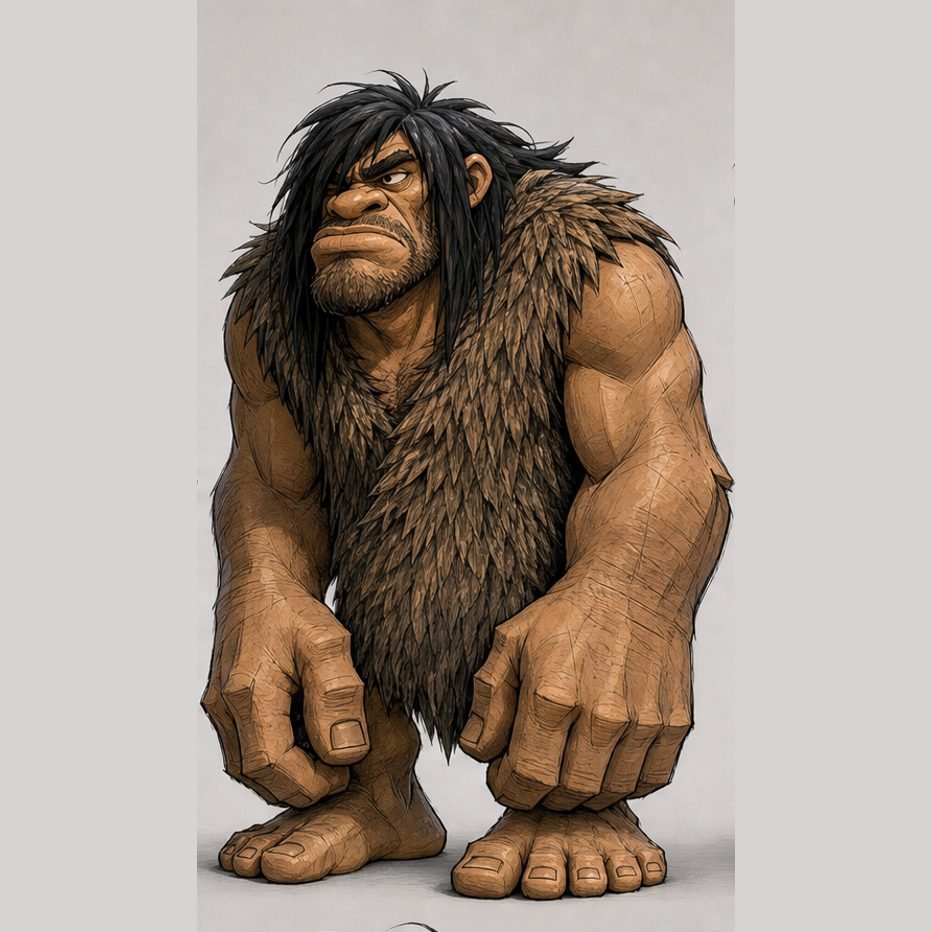
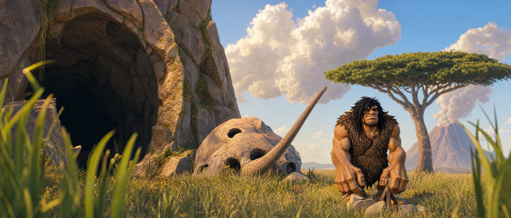

# IF: a stylized 3D cartoon, built from my own drawings

**Status: in development (started October 2026).** Second project of my AI filmmaking studio, after
[KimKatcher](../README.md). Where KimKatcher is a realistic action series, IF tests the opposite question:
**can an AI pipeline keep an author's hand-drawn style all the way to a 3D animated shot?**

## The concept
A man from one era (Zak, a caveman, then his descendants) faces a simple problem. An object from another era
would solve it instantly, but he has no idea how to use it. A voice-over opens and closes each episode, under the
title "if". A recurring gag: an elastic arm reaching in from off-screen, the viewer's own "for heaven's sake,
here, take the lighter!".

- **Format:** 60 to 90 seconds. One fixed shot (character in the foreground, an architectural element, a living
  background), opened and closed by a vertical camera move between the sky and the scene.
- **Audience:** children 6 to 12 and families. Target buyers: animation studios.
- **Look:** stylized 3D that keeps the ink line, hatching and slightly choppy animation of a drawing, in the spirit
  of Spider-Verse or Puss in Boots 2. Not smooth Pixar 3D, not realism.

## From a pencil sketch to a 3D shot

| Step | What | Tools |
|---|---|---|
| 1 | Original character sketch, and a written style bible extracted from 42 of my drawings (proportions, shapes, faces, hands, line) | Pencil, Claude |
| 2 | Character turnaround and expression sheet, generated from the sketch and the style references | Image generation (Astra) |
| 3 | 3D model generated from the turnaround, then cut, rigged and weighted by hand (spine, arms, legs, 4 fingers with 3 phalanges, independent eyes) | Hyper3D, Blender |
| 4 | Scene blocked in Blender: 21:9 fixed camera, low angle, depth of field on Zak, cave, plain, volcano | Blender |
| 5 | Blender layout repainted by image generation ("keep the layout, repaint everything") | Astra |
| 6 | Next: animation, voice-over, sound, edit | |

A dedicated "art director" agent checks each generated image against the style bible and rewrites the
correction prompt, so the style stays mine rather than the model's default.

## Images

| | |
|---|---|
|  Original sketch of Zak |  Concept sketch: the caveman and the lighter |
|  Style target: one of my drawings rendered in volume |  Turnaround and expressions |
|  Rigged 3D model (Blender) |  Episode 1 fixed shot, Blender layout repainted |

## What I am testing
- **Style fidelity:** a written style bible plus a small set of reference drawings, sent with every generation.
- **Control:** Blender for layout, camera and character pose; generation only for the final look.
- **Reuse:** the same studio rules and pipeline as KimKatcher (see [method](../method/)).

All drawings, characters and concept © Jérémie Borrotzu.
